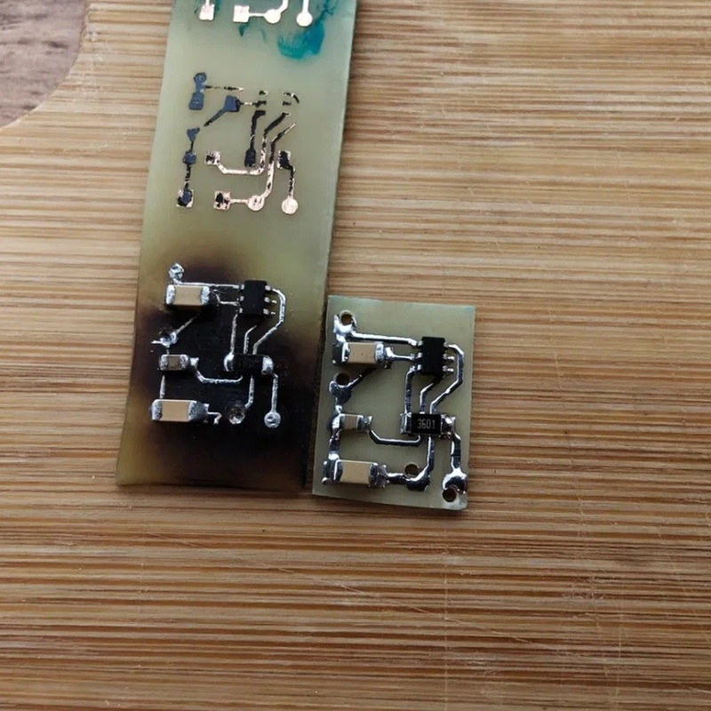
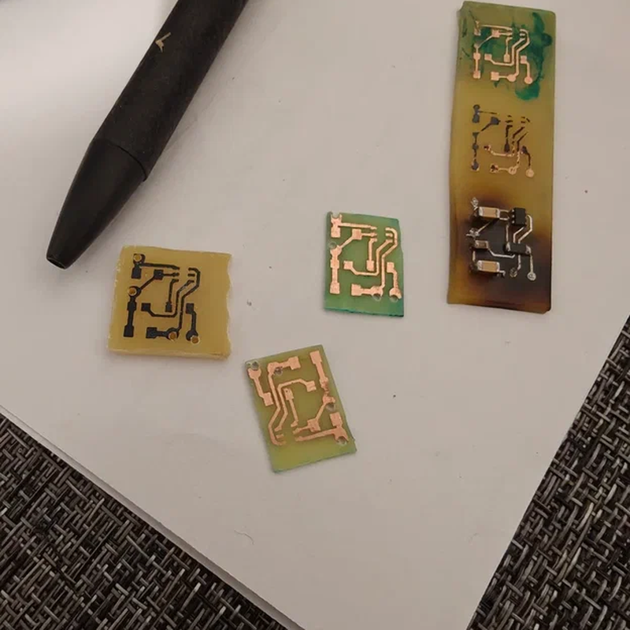
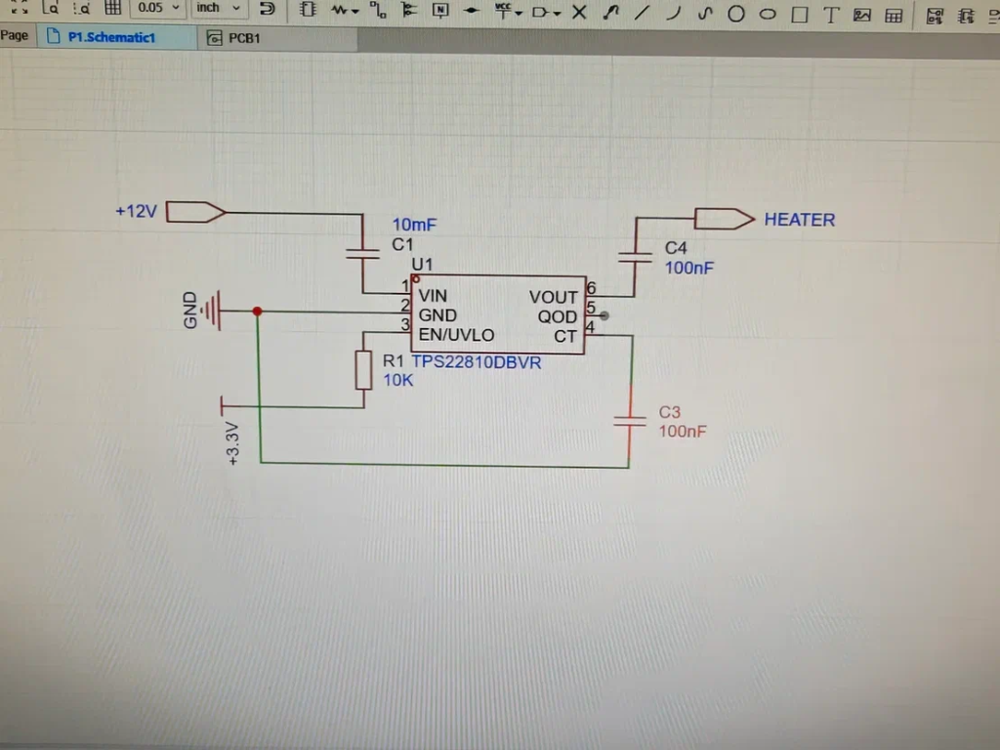
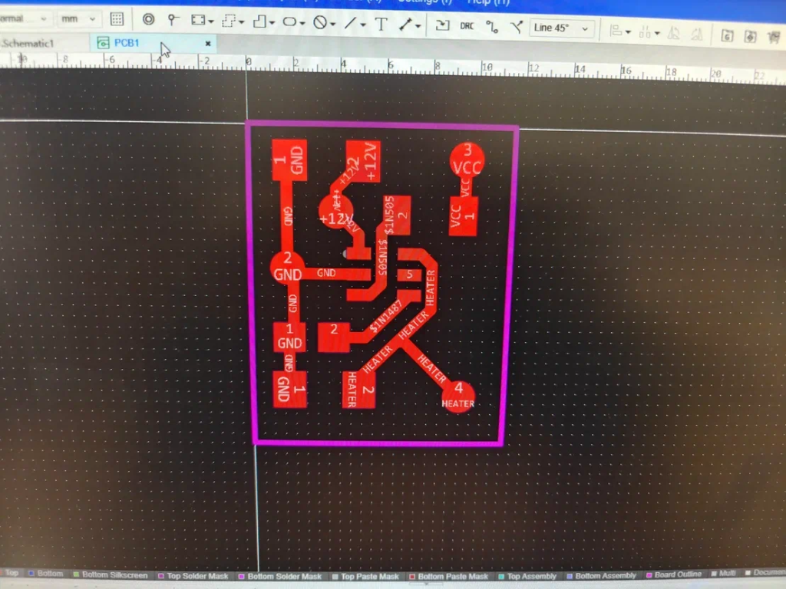

# 🚗 CamAssist — Умный блок управления обогревом камеры ассистентов (ADAS) на ESP32

[](https://www.espressif.com/)
[](https://github.com/gda96/CamAssist/releases/download/v1.82/Cam_assist_v1.82.apk)
[](LICENSE)

Готовое аппаратное и программное решение для устранения проблемы **запотевания и обледенения лобового стекла в зоне камеры систем помощи водителю** (ADAS: Lane Assist, Sign Assist, Front Assist, автодальний свет).

---

### В чем проблема и зачем нужен CamAssist?
В сырую или морозную погоду замкнутый пластиковый кожух камеры за салонным зеркалом заднего вида запотевает изнутри. Штатный обдув лобового стекла туда практически не проникает, камера «слепнет», и все ассистенты отключаются с ошибкой на приборной панели.

**CamAssist** непрерывно считывает показания температуры и влажности внутри кожуха цифровым датчиком, автоматически рассчитывает точку росы и плавно включает нагревательный элемент до выпадения конденсата, а также строго защищает лобовое стекло от локального перегрева.

---

## 📋 Содержание

1. [Что необходимо для сборки (Полный BOM)](#-что-необходимо-для-сборки-полный-bom)
2. [Твердотельный силовой ключ на TPS22810 (Вместо реле)](#-твердотельный-силовой-ключ-на-tps22810-вместо-реле)
3. [Выбор платформы: ESP32-C3 Super Mini vs ESP32-C5](#-выбор-платформы-esp32-c3-super-mini-vs-esp32-c5)
4. [Распиновка и пошаговая распайка](#-распиновка-и-пошаговая-распайка)
5. [Безопасное подключение к электрике автомобиля](#-безопасное-подключение-к-электрике-автомобиля)
6. [Прошивка и скетчи под обе версии плат](#-прошивка-и-скетчи-под-обе-версии-плат)
7. [Android-приложение и веб-интерфейс](#-android-приложение-и-веб-интерфейс)
8. [Лицензия](#-лицензия)

---

## 🧰 Что необходимо для сборки (Полный BOM)

### 1. Основные модули системы
| Элемент | Модель / Описание | Кол-во | Примечание |
| :--- | :--- | :---: | :--- |
| **Микроконтроллер** | **ESP32-C3 Super Mini** *или* **ESP32-C5** | 1 шт. | C3 — миниатюрный (22.5×18 мм); C5 — двухдиапазонный Wi-Fi 6 (2.4 / 5 ГГц). |
| **Датчик температуры и влажности** | **GY-21 (SHT21)** на шине I2C | 1 шт. | Прецизионный датчик Sensirion. **Питание строго 3.3V!** |
| **Сенсорная кнопка** | **TTP-223** (красный мини-модуль) | 1 шт. | Скрытая установка под пластик кожуха (ручной пуск и сброс Wi-Fi). |
| **Преобразователь питания (DC-DC)** | Понижающий модуль **12V $\to$ 5V** (mini360 / MP1584EN) | 1 шт. | Импульсный стабилизатор с током от 2А. |

### 2. Компоненты твердотельного ключа нагрузки (Custom PCB)
| Элемент | Позиция | Номинал / Типоразмер | Кол-во | Назначение |
| :--- | :---: | :--- | :---: | :--- |
| **Силовой ключ (Load Switch)** | **U1** | **Texas Instruments TPS22810DBVR** (SOT-23-6, марк. `19HF`) | 1 шт. | Твердотельная бесшумная коммутация нагрузки до 2.7А, $V_{IN}$ 2.7–18V. |
| **Входной конденсатор** | **C1** | **10 µF** (SMD 1206 / 0805, 25–50V, X7R/X5R) | 1 шт. | Сглаживание просадок и фильтрация питания +12V. |
| **Конденсатор плавного пуска**| **C3** | **100 nF (0.1 µF)** (SMD 0805, 25–50V, X7R) | 1 шт. | Управление нарастанием напряжения (Soft-Start) на выводе `CT`. |
| **Выходной конденсатор** | **C4** | **100 nF (0.1 µF)** (SMD 0805, 25–50V, X7R) | 1 шт. | Высокочастотный фильтр на линии нагрузки `VOUT`. |
| **Подтягивающий резистор** | **R1** | **10 кОм** (SMD 0805, 0.125W) | 1 шт. | Притяжка входа `EN/UVLO` к GND (защита от ложного включения). |
| **Печатная плата** | **PCB** | Односторонний фольгированный текстолит (~15×10 мм) | 1 шт. | Травление ЛУТ / фоторезист. |

### 3. Автомобильный монтаж и расходники
* **Разветвитель предохранителя (Add-a-Fuse / Fuse Tap):** Mini, Micro2 или Standard (под блок авто).
* **Автомобильный флажковый предохранитель:** **3А или 5А** — 1 шт.
* **Провода:**
  * Силовая линия (+12V и нагреватель): гибкий медный провод сечением **$0.75 - 1.0\text{ мм}^2$**.
  * Сигнальные цепи (кнопка, датчик): провод **$0.2 - 0.35\text{ мм}^2$** (витая пара / шлейф).
* **Термоусадочные трубки**, антискрип-лента (мохнатая лента Tesa), нейтральный силикон.

### 4. Детали для 3D-печати
| Элемент | Файл модели STL | Описание | Рекомендуемый пластик |
| :--- | :--- | :--- | :--- |
| **Кронштейн датчика GY-21** | [`3d_models/Bra-Camera-Sensor-2VAR-GY-21.stl`](3d_models/Bra-Camera-Sensor-2VAR-GY-21.stl) | Специализированный кронштейн-держатель для надежной фиксации датчика внутри кожуха камеры 2Q0 (Tiguan / платформа MQB). | **PETG**, **ABS** или **ASA** (термостойкость на солнце до $80^\circ\text{C}$; обычный PLA может размягчаться). |

---

## ⚡ Твердотельный силовой ключ на TPS22810 (Вместо реле)

В проекте намеренно **исключено громоздкое электромагнитное реле** (Songle и аналоги). Вместо него разработан специализированный миниатюрный модуль силового ключа на специализированной интегральной микросхеме **Texas Instruments TPS22810DBVR**.

<p align="center">
  
  
</p>

### Почему это решение в разы лучше обычного реле:
1. 📏 **Сверхкомпактность:** Размеры платы всего **~15 × 10 мм**! Модуль легко помещается даже в самый тесный кожух за зеркалом вместе с ESP32-C3 Super Mini.
2. 🔇 **Абсолютная бесшумность:** Никаких щелчков над головой водителя при автоматическом включении и отключении подогрева.
3. ⚡ **Прямое управление от 3.3В логики ESP32:** Порог переключения входа `EN` микросхемы TPS22810 составляет ~1.1В, а входной ток — доли микроампера. Не нужны транзисторы раскачки (2N2222), оптопары или согласователи уровней.
4. 🛡️ **Мягкий пуск (Soft-Start via CT):** Конденсатор C3 (100 нФ) на выводе `CT` обеспечивает плавное контролируемое нарастание напряжения на нагревателе. Это полностью устраняет броски пускового тока в бортовой сети авто и продлевает жизнь нагревательному элементу.
5. 🛡️ **Полный комплекс встроенных защит:** Интегрированная термозащита (Thermal Shutdown при $150^\circ\text{C}$), защита от просадки напряжения (UVLO) и функция быстрого снятия остаточного заряда (Quick Output Discharge).
6. ❄️ **Отсутствие индуктивных выбросов:** Поскольку коммутирующим элементом выступает интегрированный N-MOSFET с сопротивлением открытого канала всего $79\text{ м}\Omega$, катушка индуктивности отсутствует — диод гашения обратной ЭДС не требуется, а падение напряжения и нагрев минимальны.

---

### Принципиальная схема твердотельного ключа:

<p align="center">
  
</p>

```
                  +12V (Линия ACC через предохранитель 3-5A)
                    │
                    ├──[ C1 10µF ]──┐ (Фильтр по входу)
                    │               │
                 ┌──┴───────────────┴──┐
                 │  1 (VIN)     (VOUT) 6 ──┬──> Нагреватель (+12V)
                 │                     │   │
                 │      U1: TPS22810   │  [ C4 100nF ] (Фильтр выхода)
                 │      (SOT-23-6)     │   │
ESP32 (GPIO 3) ──┤  3 (EN)       (QOD) 5 ──┘
3.3V логика      │  2 (GND)       (CT) 4 ──[ C3 100nF ]──┐ (Soft-Start)
                 └──┬──────────────────┘                 │
                    │                                    │
                    ├──[ R1 10k ]────────────────────────┤ (Pull-Down)
                    │                                    │
────────────────────┴────────────────────────────────────┴── GND (Масса)
```

---

### Топология и трассировка печатной платы:

<p align="center">
  
</p>

#### Назначение контактных площадок платы ключа:
* **Pin 1 (GND):** Общий минус (кузов / масса автомобиля и GND микроконтроллера).
* **Pin 2 (+12V):** Вход постоянного питания 12В от линии ACC (клемма 15).
* **Pin 3 (VCC / EN):** Управляющий сигнал 3.3В от контакта `GPIO 3` микроконтроллера ESP32 (`HIGH` = ключ открыт, нагрев включен).
* **Pin 4 (HEATER):** Силовой коммутируемый выход +12В на контакт нагревателя стекла.

---

### 📄 Файлы для самостоятельного изготовления платы (ЛУТ / Фоторезист):

В репозитории подготовлены готовые шаблоны для печати на лазерном принтере со 100% масштабом и защитой от искажения размеров:

| Файл | Описание | Формат | Назначение |
| :--- | :--- | :---: | :--- |
| 🖨️ **[`hardware/PCB_TPS22810_Print_A4.pdf`](hardware/PCB_TPS22810_Print_A4.pdf)** | **Мастер-лист А4 для печати** (1:1 масштаб, контрольная линейка 50 мм, 8 копий для ЛУТ (зеркально) + 8 копий для фоторезиста + сборочный чертеж) | PDF (A4) | **Основной файл для печати шаблона на принтере** |
| 📐 **[`hardware/PCB_TPS22810_Single_1x1.pdf`](hardware/PCB_TPS22810_Single_1x1.pdf)** | Одиночная выровненная плата 1:1 (9.4 × 12.3 мм) | PDF (1:1) | Импорт в векторные редакторы и CAM-софт |
| 📁 **[`hardware/PCB_PCB1_2025-12-16.pdf`](hardware/PCB_PCB1_2025-12-16.pdf)** | Исходный файл экспорта слоев из EasyEDA (от 16.12.2025) | PDF | Исходник |

#### Что исправлено и оптимизировано в выровненном шаблоне печати:
1. **Калибровочная шкала 50 мм и тестовый квадрат 10×10 мм:** при печати в Acrobat / браузере обязательно выберите **«Реальный размер» (100%)**, НЕ «По размеру страницы». Проверьте линейкой: тестовая шкала должна быть ровно 50.0 мм.
2. **Выравнивание земляной шины GND:** вертикальная шина GND слева выведена в прямую линию без ступенек и угловых изломов, что исключает подтравливание меди.
3. **Подключение вывода QOD (Pin 5):** вывод быстрого разряда TPS22810 надежно соединен с силовой линией выхода HEATER (в точном соответствии со схемой и даташитом Texas Instruments).
4. **Симметричные зазоры сигнальной линии EN:** дорожка между выводами SOT-23 отцентрована с равными изолирующими зазорами по 0.36 мм с обеих сторон для защиты от замыкания при домашней пайке.
5. **Центровочные точки кернения:** в центрах круглых контактных площадок сформированы направляющие метки 0.5 мм для точного позиционирования сверла 0.7–0.8 мм.
6. **Запас для нескольких попыток:** на листе размещено по 8 копий каждого варианта (зеркальный для ЛУТ и прямой для фоторезиста) с тонкими габаритными контурами для резки.

---

## 🔬 Выбор платформы: ESP32-C3 Super Mini vs ESP32-C5

В репозитории подготовлены отдельные готовые скетчи для двух вариантов микроконтроллеров:

* **ESP32-C3 Super Mini — Компактность и простота:**
  * **Габариты:** всего 22.5 × 18 мм (размер с почтовую марку). Свободно помещается в компактный штатный кожух камеры ADAS за салонным зеркалом.
  * **Беспроводная связь:** Wi-Fi 4 (диапазон 2.4 ГГц).
  * **Подключение датчика:** шина I2C на пинах `GPIO 8` (SDA) и `GPIO 9` (SCL).
  * **Назначение:** оптимален для работы в режиме собственной точки доступа (`Camera_Heater_AP`) или подключения к стандартным сетям 2.4 ГГц.

* **ESP32-C5 (ESP32-C5-WROOM-1) — Чистый эфир и Wi-Fi 6:**
  * **Габариты:** стандартный форм-фактор отладочной платы.
  * **Беспроводная связь:** Dual-Band Wi-Fi 6 (одновременная поддержка частот 2.4 ГГц и 5 ГГц, протокол 802.11ax).
  * **Подключение датчика:** аппаратный Low-Power I2C на пинах `GPIO 6` (SDA) и `GPIO 7` (SCL), не связанный со светодиодом платы.
  * **Назначение:** стабильная и быстрая связь в условиях перегруженного автомобильного радиоэфира (Bluetooth, регистраторы, телефоны) при подключении к 5 ГГц роутеру авто или точке доступа смартфона.

---

## 🛠️ Распиновка и пошаговая распайка

### Сводная таблица соединений:

| Назначение | Пин ESP32-C3 | Пин ESP32-C5 | Куда подключается |
| :--- | :---: | :---: | :--- |
| **Управление ключом** | `GPIO 3` | `GPIO 3` | Вход `EN` (Pin 3) платы ключа нагрузки (`HIGH` = обогрев ВКЛ) |
| **Сенсорная кнопка** | `GPIO 2` | `GPIO 2` | Выход `IO` сенсорного модуля TTP-223 |
| **Датчик I2C (SDA)** | `GPIO 8` | `GPIO 6` | Пин `SDA` датчика GY-21 (SHT21) |
| **Датчик I2C (SCL)** | `GPIO 9` | `GPIO 7` | Пин `SCL` датчика GY-21 (SHT21) |
| **Питание датчика** | `3V3` | `3V3` | Пин `VCC` датчика (**Строго 3.3V!**) |
| **Питание кнопки** | `3V3` | `3V3` | Пин `VCC` кнопки TTP-223 |
| **Общая земля** | `GND` | `GND` | Общий минус питания и сигналов (GND) |
| **Вход питания 5В** | `5V / VIN` | `5V / VIN` | Выход +5В от автомобильного DC-DC преобразователя |

---

### Пошаговая инструкция:

#### Шаг 1. Конфигурация сенсорной кнопки TTP-223
На тыльной стороне модуля TTP-223 расположены две пары перемычек под пайку: **A** и **B**:
* **Перемычку A — ЗАПАЯТЬ (A=1):** инвертирует уровень сигнала (в покое выдает высокий уровень, при касании пальцем — `LOW` / 0В).
* **Перемычку B — ОСТАВИТЬ РАЗОМКНУТОЙ (B=0):** режим обычной кнопки без фиксации состояния (Direct mode).

#### Шаг 2. Распайка датчика GY-21 (SHT21)
1. Используйте 4 гибких изолированных провода: `VCC` (красный), `GND` (черный), `SDA` (синий), `SCL` (желтый).
2. **Длина проводов:** делайте шлейф как можно короче (оптимально **10–15 см**, не более 25 см), так как шина I2C чувствительна к паразитной емкости длинных линий.
3. Провод `VCC` подключайте **исключительно к выходу 3.3V** микроконтроллера (от 5В сенсор Sensirion мгновенно выходит из строя).
4. Сам датчик разместите внутри пластикового кожуха как можно ближе к стеклу в зоне объектива камеры, но не закрывая обзор объективу.
5. **Установка в кронштейн (3D-печать):** Для правильного и надежного позиционирования датчика внутри кожуха камеры 2Q0 (Tiguan / платформа MQB) распечатайте модель [`3d_models/Bra-Camera-Sensor-2VAR-GY-21.stl`](3d_models/Bra-Camera-Sensor-2VAR-GY-21.stl). Датчик защелкивается в штатное посадочное место и ориентируется непосредственно в зоне контроля климата стекла.

#### Шаг 3. Распайка и сборка платы ключа TPS22810
1. Нанесите паяльную пасту на контактные площадки вытравленной платы.
2. Установите микросхему `U1 TPS22810DBVR` (ориентируйтесь по ключу первой ножки) и SMD-компоненты: `C1 (10 µF)`, `C3 (100 nF)`, `C4 (100 nF)`, `R1 (10 kΩ)`.
3. Запаяйте компоненты термофеном ($240-260^\circ\text{C}$) или тонким жалом паяльника, затем смойте остатки флюса изопропиловым спиртом.
4. Прозвоните плату мультиметром: между шинами `+12V`, `EN`, `VOUT` и `GND` не должно быть короткого замыкания.
5. Наденьте на плату отрезок прозрачной термоусадочной трубки для герметизации и изоляции от кузова.

---

## 🚗 Безопасное подключение к электрике автомобиля

Бортовая сеть автомобиля подвержена броскам напряжения до 40В (при пуске стартера и сбросе нагрузки генератора). Чтобы гарантировать безопасность проводки и не разряжать аккумулятор во время стоянки, обязательно следуйте схеме:

```
[ Автомобиль: Линия ACC (+12V Клемма 15) ]
                │
         [ Предохранитель 3A - 5A ]
                │
                ├─────────────────────────────> [ Ключ TPS22810: Pin 2 (+12V) ]
                │                                         │ (Pin 4: HEATER)
                │                                         └───> [ «+» Нагревателя ]
                ▼
   [ Импульсный DC-DC 12V -> 5V ]
                │ (+5V)
                └─────────────────────────────> [ ESP32: Пин 5V / VIN ]


[ Кузов автомобиля / Масса (GND) ] ───────────┬─> [ DC-DC: Вход/выход GND ]
                                              ├─> [ ESP32: Пин GND ]
                                              ├─> [ Ключ TPS22810: Pin 1 GND ]
                                              └─> [ «-» Нагревателя стекла ]
```

### Главные правила безопасности:
1. **Подключение ТОЛЬКО к цепи ACC (Зажигание / Клемма 15):**
   * ❌ **Ни в коем случае не подключайтесь к постоянному питанию BATT+ (Клемма 30).** Даже малый ток покоя DC-DC преобразователя и контроллера за пару недель стоянки разрядит аккумулятор.
   * ✅ Подключайтесь в салонном блоке предохранителей через переходник **Add-a-Fuse (Fuse Tap)** к цепям, обесточиваемым при выключении зажигания (прикуриватель, подогрев сидений, зеркала).
2. **Обязательный предохранитель 3А–5А:**
   * Устанавливается в разрыв плюсового провода сразу в месте подключения к блоку предохранителей авто.
3. **Импульсный DC-DC стабилизатор:**
   * Используйте качественный Step-Down импульсный преобразователь (mini360, MP1584EN). Линейные стабилизаторы (L7805) недопустимы из-за высокого тепловыделения.
4. **Сечение проводов:**
   * Силовая линия 12В (питание и нагреватель): медный провод сечением **не менее $0.75\text{ мм}^2$**.
   * Сигнальные провода (кнопка, датчик): провод сечением $0.2 - 0.35\text{ мм}^2$.
5. **Программная защита от перегрева:**
   * В логике прошивки заложен жесткий лимит: при температуре внутри кожуха **$\ge 15^\circ\text{C}$** или при ошибке чтения датчика подогрев принудительно отключается.

---

## 💾 Прошивка и скетчи под обе версии плат

Готовые исходные скетчи в репозитории:

* 🔌 **Для ESP32-C3 Super Mini:**  
  📥 **[`firmware/Cam_assist_ESP32-C3.ino`](firmware/Cam_assist_ESP32-C3.ino)**
* 🚀 **Для ESP32-C5 (Wi-Fi 6 2.4 / 5 ГГц):**  
  📥 **[`firmware/Cam_assist_ESP32-C5.ino`](firmware/Cam_assist_ESP32-C5.ino)**

### Порядок прошивки через Arduino IDE:
1. Установите **Arduino IDE 2.x**.
2. В *Настройки $\to$ Дополнительные ссылки для Менеджера плат* добавьте:  
   `https://espressif.github.io/arduino-esp32/package_esp32_index.json`
3. В *Менеджере плат* установите пакет **esp32** (версия 3.0.x или свежее).
4. В *Менеджере библиотек* установите библиотеку **ArduinoJson** (версия 6.x).
5. Параметры платы в меню *Инструменты (Tools)*:
   * **Для ESP32-C3:** Плата `ESP32C3 Dev Module`, Flash Size: `4MB`, Partition Scheme: `Huge APP (3MB No OTA/1MB SPIFFS)` *(обязательно из-за объема встроенной веб-страницы в flash)*, USB CDC On Boot: `Enabled`.
   * **Для ESP32-C5:** Плата `ESP32C5 Dev Module`, Flash Size: `4MB` или `8MB`, Partition Scheme: `Huge APP`.
6. Нажмите **Загрузка (Upload)**.

---

## 📱 Android-приложение и веб-интерфейс

### Готовое приложение для Android:
* 📥 **[Скачать файл Cam_assist_v1.82.apk](https://github.com/gda96/CamAssist/releases/download/v1.82/Cam_assist_v1.82.apk)**
* 📦 **[Страница релиза v1.82 на GitHub Releases](https://github.com/gda96/CamAssist/releases/tag/v1.82)**

Приложение устанавливается на любой смартфон, планшет или автомагнитолу (головное устройство) под управлением ОС Android.

#### Возможности и интерфейс приложения:
* **Мониторинг климата в реальном времени:** непрерывное отображение текущей температуры, относительной влажности, расчетной точки росы и статуса нагревателя (ВКЛ / ВЫКЛ).
* **Автоматическое обнаружение платы:** поиск устройства в локальной сети по UDP Broadcast (вводить IP-адрес вручную не требуется).
* **Управление режимами:**
  * **АВТО:** автоматический подогрев по расчетной точке росы для предотвращения запотевания.
  * **РУЧНОЙ:** принудительное включение нагрева на 5 минут с автоматическим возвратом в авто-режим.
  * **ВЫКЛЮЧЕНО:** полная блокировка обогрева (летний режим).
* **Калибровка датчика:** точная подстройка смещений температуры ($\pm 10^\circ\text{C}$) и влажности ($\pm 20\%$) прямо из приложения.
* **Настройка беспроводной сети:** сканирование доступных точек доступа и подключение платы к Wi-Fi сети автомобиля или телефона.

### Встроенный веб-интерфейс (управление без установки приложения):
Если приложение не установлено, настройка доступна с любого смартфона или ноутбука через браузер:
1. Подключитесь к Wi-Fi сети устройства: **`Camera_Heater_AP`** (пароль по умолчанию: **`12345678`**).
2. Откройте любой браузер и перейдите по адресу: **`http://192.168.4.1`**.
3. Загрузится встроенный адаптивный веб-интерфейс с полной панелью мониторинга, кнопками управления и меню конфигурации.

---

## 📄 Лицензия

Проект распространяется под свободной лицензией **MIT**. Подробности в файле [LICENSE](LICENSE).
